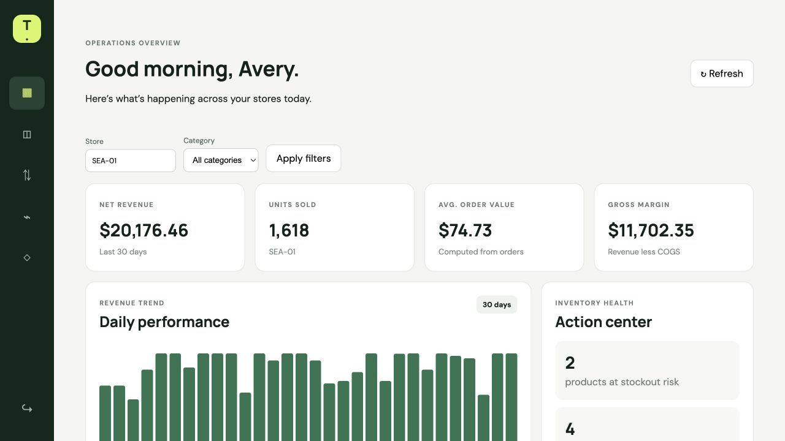
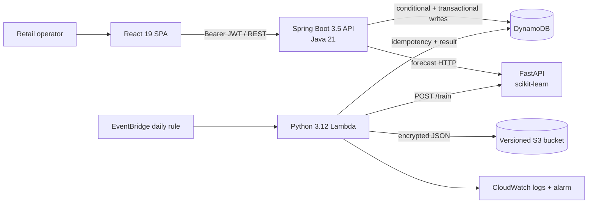
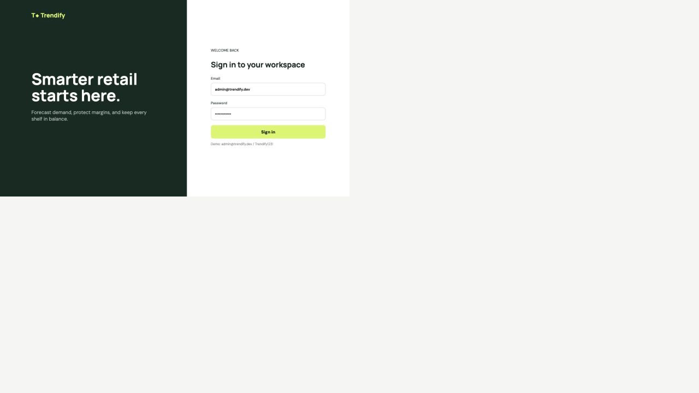

# Trendify

**AI-driven retail operations with transactional inventory, leakage-safe forecasting, and human-governed pricing.**

Trendify is a full-stack engineering portfolio project for multi-store retail operations. It combines a React dashboard, a Spring Boot system-of-record API, DynamoDB concurrency controls, a FastAPI/scikit-learn forecasting service, an idempotent AWS Lambda batch workflow, and Terraform infrastructure. The repository runs locally without an AWS account.

> Verification snapshot (2026-10-17): **88 automated tests passed, 0 failed, 0 skipped; 50/51 documented requirements passed; live AWS sandbox verification remains blocked.** Every metric below links to the executed [test report](docs/TEST_REPORT.md), with individual scenarios in the [test plan](docs/TEST_PLAN.md).



## Why this project is interesting

- **Correctness under contention:** multi-line orders use one DynamoDB transaction. Each decrement requires the expected product version, sufficient stock, and the caller's store; the order and every stock change commit together or not at all.
- **Domain-level uniqueness:** a normalized, store-scoped SKU lock is conditionally written in the same transaction as product metadata, preventing duplicates without a relational unique index.
- **Tenant isolation:** signed JWTs carry role and store scope. Authorization is enforced server-side across catalog, inventory, orders, analytics, and recommendations; administrators may select stores explicitly.
- **Responsible ML behavior:** chronological evaluation and shifted features prevent target leakage. Primary-model failures degrade to a seven-day seasonal-naive forecast; a dual failure returns a controlled `503`.
- **Human-in-the-loop pricing:** margin and ±10% price guardrails run before a recommendation becomes `PENDING`. Approval or rejection is a one-time conditional decision with a durable append-only audit record.
- **Operationally safe scheduling:** EventBridge invokes an idempotent Lambda. A conditional run claim prevents duplicate training, completed results are replayable, and result metadata is persisted to DynamoDB and encrypted S3.

## Implemented capabilities

| Area | Verified implementation |
|---|---|
| Identity | BCrypt demo identities, expiring HMAC JWTs, role matrix, restricted CORS, correlation IDs |
| Catalog | Product CRUD, validation, full-key pagination tokens, store/category filtering, store-scoped SKU uniqueness |
| Inventory and orders | Non-negative stock conditions, optimistic versions, movement history, transactional multi-line orders |
| Dashboard | Revenue, units, AOV, margin, 30-day trend, inventory risk, store/category filters, loading/empty/error states |
| Forecasting | Deterministic synthetic data, lag/rolling features, chronological split, HistGradientBoosting, naive benchmark/fallback |
| Decisions | Dynamic-pricing constraints, explanations, durable approval/rejection history, reorder/safety-stock calculations |
| AWS workflow | EventBridge schedule, Python Lambda, idempotent DynamoDB run state, encrypted/versioned S3 artifacts, alarm/log retention |
| Delivery | Docker Compose, GitHub Actions, OpenAPI, JaCoCo/coverage.py/V8, Playwright, k6, Terraform checks |

## Architecture



The API is a modular monolith: catalog, inventory, orders, analytics, and recommendation modules share one deployable boundary so business invariants can be enforced without distributed transactions. Python is isolated where its ML runtime and scaling characteristics differ. See [Architecture](docs/ARCHITECTURE.md) and the [ADRs](docs/adr).

## Technology

| Layer | Technology |
|---|---|
| Web | React 19, TypeScript 6, Vite 7, React Router, Nginx |
| API | Java 21, Spring Boot 3.5, Spring Security, Bean Validation, springdoc OpenAPI |
| Data | DynamoDB single-table model, AWS SDK v2, DynamoDB Local |
| ML | Python 3.12, FastAPI, pandas, NumPy, scikit-learn, joblib |
| Cloud/IaC | Lambda, EventBridge, S3, CloudWatch, IAM, Terraform |
| Quality | JUnit 5, Mockito, MockMvc, Testcontainers, pytest, Vitest, Playwright, k6, JaCoCo |

## Genuine application screenshots

Captured on 2026-10-16 from the locally running Docker Compose application; these are not mockups.

| Sign in | Operations dashboard |
|---|---|
|  |  |

## Run locally

### Docker Compose

Prerequisite: Docker Desktop with Compose v2. No local Java, Node, Python, DynamoDB, or AWS credentials are required.

```bash
git clone <YOUR_REPOSITORY_URL>
cd trendify
cp .env.example .env
# Set JWT_SECRET to a new value with at least 32 characters.
docker compose up --build
```

Open:

- Application: `http://localhost:4200`
- Spring health: `http://localhost:8080/actuator/health`
- OpenAPI UI: `http://localhost:8080/swagger-ui.html`
- ML health/docs: `http://localhost:8001/health` and `http://localhost:8001/docs`

Demo users all use `Trendify123!` and exist only for deterministic local evaluation:

| Role | Email | Store scope |
|---|---|---|
| Administrator | `admin@trendify.dev` | Explicitly selected store (`*`) |
| Store manager | `manager@trendify.dev` | `SEA-01` |
| Store manager | `portland@trendify.dev` | `PDX-01` |
| Inventory analyst | `analyst@trendify.dev` | `SEA-01` |

Stop with `docker compose down`. Use `docker compose down -v` only when you intentionally want to remove local DynamoDB/model volumes.

### Installation verification

These instructions were rechecked on 2026-10-16 with the isolated Compose project `trendifyverify`: all four containers started, the ML service became healthy, Compose configuration parsed, and the browser rendered authenticated API data. Image rebuilding was not repeated during this documentation-only pass because the same isolated images were already built and verified in the test run. This is local verification—not an AWS deployment claim.

## API examples

Authenticate and list products:

```bash
TOKEN=$(curl -fsS http://localhost:8080/api/auth/login \
  -H 'Content-Type: application/json' \
  -d '{"email":"admin@trendify.dev","password":"Trendify123!"}' \
  | jq -r .accessToken)

curl -fsS -H "Authorization: Bearer $TOKEN" \
  'http://localhost:8080/api/products?storeId=SEA-01&category=Beverages'
```

Read the filtered dashboard:

```bash
curl -fsS -H "Authorization: Bearer $TOKEN" \
  'http://localhost:8080/api/analytics/dashboard?days=30&storeId=SEA-01&category=Beverages'
```

Create an order using the current product version:

```bash
curl -fsS -X POST \
  -H "Authorization: Bearer $TOKEN" -H 'Content-Type: application/json' \
  'http://localhost:8080/api/orders?storeId=SEA-01' \
  -d '{"lines":[{"productId":"PRODUCT_ID","quantity":1,"expectedVersion":1}]}'
```

Request a forecast:

```bash
curl -fsS -X POST http://localhost:8001/forecast \
  -H 'Content-Type: application/json' \
  -d '{"sku":"SKU-COFFEE-01","horizon":7}'
```

## ML methodology

The generator produces reproducible daily SKU histories with seeded seasonality and promotions. The pipeline sorts each SKU chronologically, shifts lags and rolling windows before fitting, and reserves the newest 20% for evaluation. A `HistGradientBoostingRegressor` is evaluated with MAE, RMSE, and zero-safe WAPE against a seven-day seasonal-naive baseline. Forecast responses include model version, training timestamp, metrics, and limitations.

This is a pipeline demonstration, not proof of real-world demand accuracy or price elasticity. The dataset is synthetic; recursive forecasts accumulate uncertainty; no calibrated intervals, holiday calendar, drift monitor, or production model registry is implemented. Real adoption would require store-level backtests on production data, bias/drift monitoring, and a champion/challenger gate.

## Security model

- JWT signature and expiry are validated on protected routes; the secret must be at least 32 characters.
- Server-side role rules constrain mutations, while `StoreAccess` rejects cross-store selection before data access.
- Stock, order, SKU, and price-decision conditions are enforced in DynamoDB, not only in controllers or UI state.
- API errors omit internal exception messages; login responses never return password data.
- CORS is an explicit allowlist, correlation IDs support tracing, and CI uses no real AWS credentials.
- Terraform grants Lambda only the DynamoDB/S3/log actions required by the batch flow.

For production, replace bootstrapped users and browser `localStorage` tokens with managed identity, secure cookie/BFF or hardened token storage, refresh-token revocation, managed secret rotation, TLS/private ML networking, and abuse controls. See [SECURITY.md](SECURITY.md).

## Verification evidence

The values below are copied from the committed [test report](docs/TEST_REPORT.md).

| Evidence | Executed result |
|---|---:|
| Automated tests | **88 passed, 0 failed, 0 skipped** |
| Requirements | **50 PASS, 0 FAIL, 0 SKIPPED, 1 BLOCKED** |
| Java line / branch coverage | **90.36% / 73.15%** |
| Python line coverage | **91%** |
| React line / branch coverage | **100% / 81.63%** |
| Playwright | **4 passed** |
| k6 | **452/452 checks; dashboard p95 52.78 ms** (threshold 500 ms) |
| Terraform | **fmt, offline init, and validate passed** |

Run the same layers:

```bash
# Java + Testcontainers + JaCoCo
cd backend && mvn -B verify

# Python + coverage
cd ../ml-service
python -m venv .venv && source .venv/bin/activate
pip install -r requirements.txt
pytest --cov=app --cov-report=term-missing --cov-report=html -q

# React + Playwright
cd ../frontend
npm ci && npm test && npm run build
npx playwright install chromium
npx playwright test

# Terraform static validation; does not provision AWS
cd ../infrastructure/terraform
terraform fmt -check -recursive
terraform init -backend=false
terraform validate
```

With Compose running, run the k6 smoke scenario:

```bash
docker run --rm --network host \
  -v "$PWD/performance:/scripts" grafana/k6:0.54.0 run \
  -e BASE_URL=http://127.0.0.1:4200 -e VUS=5 -e DURATION=30s \
  /scripts/smoke.js
```

GitHub Actions runs backend, Python, frontend, E2E, performance, and Terraform as independent jobs and uploads coverage/E2E artifacts.

## Engineering tradeoffs

| Decision | Benefit | Cost / next step |
|---|---|---|
| Modular monolith API | Local invariants and simple deployment | Split only when scaling or team ownership supports it |
| DynamoDB single table | Atomic conditions and predictable key access | Current filtered catalog scan needs a store/category GSI at production volume |
| Embedded order snapshots | Immutable name/price at purchase time | Larger items; cap line count and validate DynamoDB's item limit |
| Separate Python service | Native ML toolchain and independent runtime | HTTP boundary; add private networking, auth, timeouts, and circuit breaking |
| Deterministic KPI history | Repeatable demo and tests | Dashboard does not yet aggregate persisted orders |
| Human pricing approval | Auditability and risk control | Requires operator notification and richer workflow |

## Known limitations

- **Live AWS verification is pending.** `CLOUD-001` is blocked because no sandbox account/credentials were supplied. EventBridge delivery, deployed IAM enforcement, real DynamoDB/S3 persistence, CloudWatch alarm behavior, and teardown have not run in AWS.
- Dashboard history is deterministic demo data; operational orders are durable but are not yet the KPI source.
- Catalog filtering uses a scan suitable for this bounded demo, not high-volume production access.
- Demo identities are in-process; there is no account lifecycle, refresh-token revocation, or password-reset flow.
- The UI exposes dashboard/filter/order workflows; catalog administration, pricing approval, and forecasting remain API-driven.
- Synthetic-model metrics do not establish production accuracy.

## Documentation

- [Architecture](docs/ARCHITECTURE.md)
- [Test plan](docs/TEST_PLAN.md) and [test report](docs/TEST_REPORT.md)
- [Interview guide](docs/INTERVIEW_GUIDE.md)
- [Five-minute demo](docs/DEMO_SCRIPT.md)
- [Publication checklist and portfolio copy](docs/PUBLICATION_CHECKLIST.md)
- [Contributing](CONTRIBUTING.md), [security policy](SECURITY.md), and [ADRs](docs/adr)

## License

[MIT](LICENSE)
