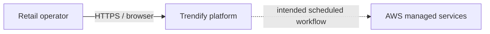
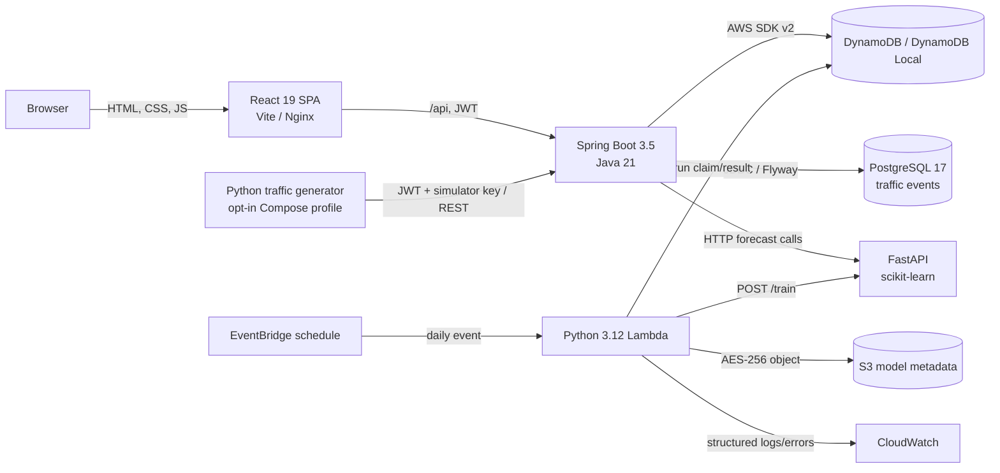
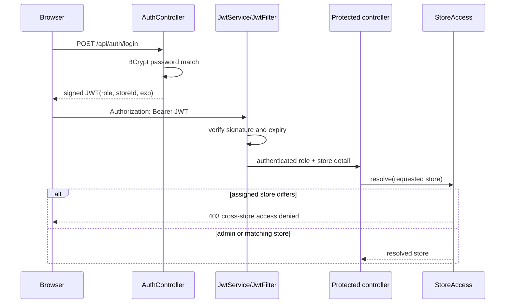
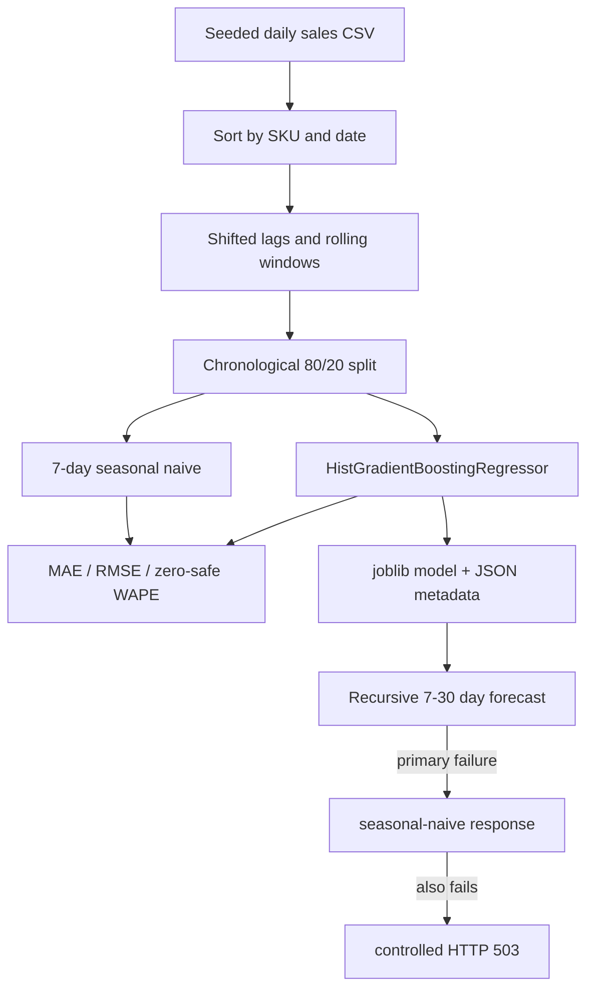
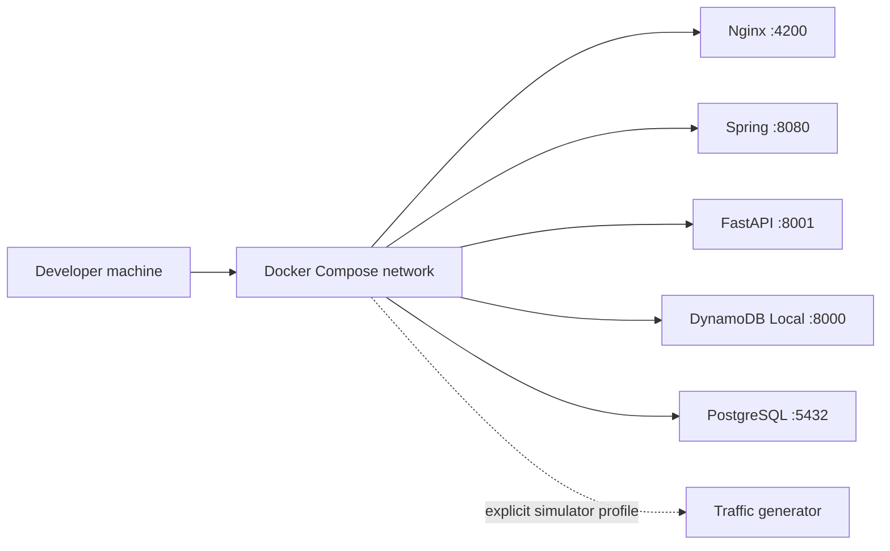

# Trendify architecture

## System context

Trendify supports a retail operator who needs one view of sales indicators, catalog and stock, ordering, demand forecasts, pricing decisions, and replenishment signals. The locally runnable system includes React, Spring Boot, FastAPI, PostgreSQL, DynamoDB Local, and an opt-in Python traffic generator. The AWS module adds a scheduled Lambda, managed DynamoDB, S3, EventBridge, CloudWatch, and IAM, but has not been provisioned in a live account.



## Container view



Local Nginx serves the SPA, proxies `/api` to Spring Boot, and proxies `/ml` to FastAPI. Docker Compose supplies fake local AWS credentials only to satisfy the SDK; DynamoDB calls stay on the Compose network. The browser never contacts a database directly.

## Spring Boot system of record

The Java API is a modular monolith. This keeps product, inventory, order, authorization, and recommendation invariants within one deployable service and one DynamoDB transaction boundary.

| Package | Responsibility |
|---|---|
| `auth` | Deterministic demo users, BCrypt verification, JWT issuance |
| `security` | Bearer-token parsing, signature/expiry validation, role rules, store resolution |
| `product` | CRUD, validation, pagination, SKU locks, versioned stock writes |
| `inventory` | Maps stock-in/out/adjustment requests to signed deltas and audit records |
| `order` | Creates immutable order snapshots and atomically decrements every line |
| `analytics` | Validates dashboard filters and returns deterministic scoped KPI data |
| `recommendation` | Pricing/reorder calculations plus durable decision/audit persistence |
| `traffic` | Authenticated, idempotent event ingestion and bounded PostgreSQL aggregation |
| `common` | Safe exception mapping and correlation-ID propagation |
| `config` | DynamoDB client construction and local endpoint override |

Controllers validate HTTP input and use the authenticated principal; repositories own DynamoDB expressions. `ApiExceptionHandler` converts known validation, authorization, not-found, and conflict paths into client-safe responses while `server.error.include-message=never` avoids leaking internals.

### Authentication and authorization flow



Role checks are configured in Spring Security, while store isolation is a separate data-scope rule. The resolved store is carried into repository reads and DynamoDB conditions, so a manipulated UI parameter cannot widen access.

### Transactional order flow

```mermaid
sequenceDiagram
  participant UI as React
  participant OC as OrderController
  participant OS as OrderStore
  participant PS as ProductStore
  participant D as DynamoDB

  UI->>OC: POST /api/orders (lines + expectedVersion)
  OC->>OC: validate role, store, quantities
  OC->>OS: create(store, actor, input)
  loop each distinct line
    OS->>PS: consistent product read in store
    PS-->>OS: product + current price
    OS->>OS: snapshot line and build conditional decrement
  end
  OS->>D: TransactWriteItems(all decrements + order Put)
  Note over OS,D: store matches AND version matches AND stock >= quantity
  alt every condition passes
    D-->>OS: commit
    OS-->>UI: CONFIRMED order
  else any condition fails
    D-->>OS: TransactionCanceledException
    OS-->>UI: 400 refresh/retry; no partial decrement
  end
```

The order stores product name, SKU, unit price, quantity, and line total as an immutable purchase-time snapshot. Duplicate product lines are rejected before the transaction. A stale retry fails because the product version was incremented by the first order.

## DynamoDB data model

One table uses string `PK` and `SK` attributes. Entity types share infrastructure but retain explicit prefixes.

| Entity/access pattern | PK | SK | Integrity mechanism |
|---|---|---|---|
| Product by ID | `PRODUCT#<id>` | `META` | expected `version` + `storeId` |
| SKU uniqueness | `STORE#<store>#SKU#<SKU>` | `LOCK` | `attribute_not_exists(PK)` |
| Movement audit | `PRODUCT#<id>` | `MOVEMENT#<time>#<id>` | append-only key |
| Order | `ORDER#<id>` | `META` | transactional conditional put |
| Price recommendation | `PRICE_REC#<id>` | `META` | `PENDING` conditional transition |
| Price audit | `PRICE_REC#<id>` | `AUDIT#<time>#<id>` | appended with decision |
| Forecast run | `FORECAST_RUN#<event-id>` | `META` | conditional idempotency claim |

Creating or renaming a product transacts the metadata with its normalized SKU lock. Stock updates use `SET stockLevel = stockLevel + :delta, version = version + 1` with version, balance, and store conditions. Multi-line orders use `TransactWriteItems` so no line can succeed independently.

Catalog pages currently use a filtered scan because the dataset is deliberately bounded. DynamoDB applies `Limit` before `FilterExpression`, so `ProductStore.list` follows `LastEvaluatedKey` until it collects the requested number of matching products or exhausts the table. The opaque token encodes the complete `PK/SK` cursor. A production-volume design would add a store/category GSI and migration/backfill plan.

## React application

The frontend uses React function components, hooks, React Router, and a typed fetch client without a global state library:

- `Login` submits credentials and stores the returned JWT/store scope.
- `api` attaches the bearer token and clears the session on a protected-route `401`.
- `Dashboard` coordinates filtered dashboard and product reads, models loading/error/success/empty states, and creates a one-line order with the displayed product version.
- A successful order refreshes products so the incremented version and decremented stock replace stale client state.

Interactive routes cover login, overview, product CRUD, inventory adjustment, order creation/lookup, forecasting, pricing approval, and persisted live traffic. Customer, notification, settings, administration, richer order lifecycle, and simulator-control routes remain unimplemented.

## Python ML service

`ml-service/app/pipeline.py` owns data preparation, training, evaluation, persistence, and recursive inference. `main.py` exposes health, training, and forecast endpoints.



Lag and rolling values are shifted before calculation, so a training row cannot read its own target or a future target. The latest 20% is held out without random shuffling. WAPE is `null` when total actual demand is zero. Unknown SKUs remain `404`; the fallback is for model failure, not fabricated cold-start history.

## Scheduled forecasting on AWS

Terraform defines a daily EventBridge rule (`02:15 UTC`) that invokes `lambda/handler.py`. For each event:

1. Use the EventBridge `id` (or request ID fallback) as `run_id`.
2. Conditionally put a `RUNNING` DynamoDB item. Only one invocation can claim it.
3. If a duplicate finds `COMPLETED`, return the persisted JSON without retraining. If still running, raise so the invocation is not falsely successful.
4. Call the configured ML `/train` endpoint with a 25-second timeout.
5. Store sorted JSON in S3 with AES-256 server-side encryption and mark DynamoDB `COMPLETED` conditionally from `RUNNING`.
6. On failure, persist `FAILED`, log structured error context, and re-raise for EventBridge retries and the Lambda error metric.

The bucket has versioning and encryption; DynamoDB has server-side encryption and point-in-time recovery; logs retain 30 days; EventBridge retries twice within one hour; CloudWatch alarms on Lambda errors. The ML URL is an input because this module intentionally does not provision an always-on inference cluster.

## Reliability and observability

- Optimistic versions make lost updates visible rather than silently overwriting them.
- DynamoDB transactions protect cross-item order and SKU invariants.
- Correlation IDs are accepted or generated at the HTTP boundary and echoed in responses/logs.
- Health endpoints exist for Spring and FastAPI; Compose waits for ML health before starting the backend.
- Forecasting failure is isolated from inventory/order operations.
- GitHub Actions separates backend, Python, frontend, E2E, performance, and Terraform failures.

## Deployment views

### Local



Named volumes preserve DynamoDB data and model artifacts. No request leaves the machine for AWS.

### Intended AWS slice

The Terraform module provisions the scheduled forecasting slice only: DynamoDB, S3, Lambda, EventBridge, IAM, logs, and alarm. It does **not** provision React hosting, the Spring API, a VPC, TLS ingress, or the ML service. Consequently it is not a complete production deployment definition, and no live AWS deployment has been verified.

## Key tradeoffs and evolution

1. Keep the Java core modular until independent team ownership or scaling makes service extraction worth distributed consistency costs.
2. Replace the filtered product scan with store/category keys or GSIs before production scale.
3. Build dashboard KPIs from durable order events instead of deterministic demo history.
4. Put the ML endpoint behind private authenticated networking and add client timeouts/circuit breaking from Java.
5. Replace demo identity and `localStorage` JWTs with managed identity and a production browser-session design.
6. Add forecast intervals, holidays, drift checks, real-data backtests, and a model registry gate.

## Verification boundary

Local business logic, DynamoDB behavior, Lambda logic with mocked AWS clients, UI workflows, performance smoke, and Terraform static validity are verified in [TEST_REPORT.md](TEST_REPORT.md). Provisioned AWS behavior remains `BLOCKED` in [TEST_PLAN.md](TEST_PLAN.md) under `CLOUD-001`.
